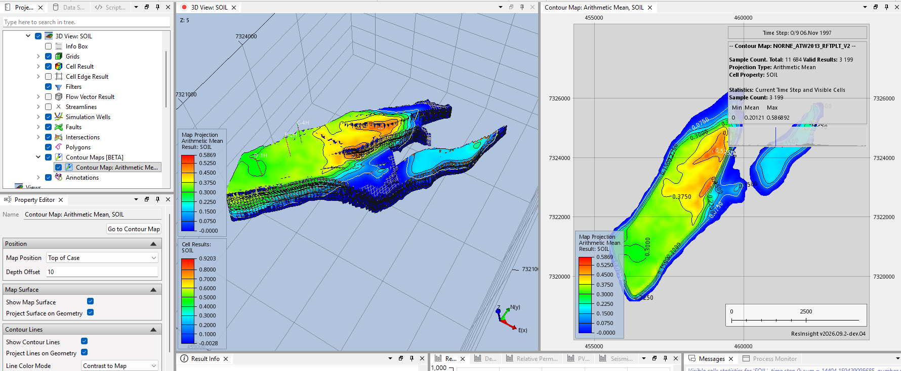

# Contour Maps in 3D Views Guide

## Overview

A contour map aggregates a 3D result onto a 2D map. It is usually shown in its own flat contour map view, which makes it hard to relate the map to the reservoir geometry and wells. A contour map can also be shown inside a regular 3D view, together with the grid, wells, faults and surfaces. The map surface and contour lines can be drawn on a flat plane, or draped onto the top of the visible geometry.

This guide uses the Norne model.



---

# Getting Started

## Model Data

The model is located in `model-data/norne`:

```
model-data/norne/NORNE_ATW2013_RFTPLT_V2.EGRID
```

The restart file `NORNE_ATW2013_RFTPLT_V2.UNRST` in the same folder provides dynamic results such as **SOIL**.

## Step 1: Import the Grid

1. Select **File > Import > Import Grid Models**
2. Select `NORNE_ATW2013_RFTPLT_V2.EGRID` in `model-data/norne`

A 3D view is created for the case.

## Step 2: Set Up the 3D View

1. Select **Cell Result** in the 3D view and set **Result Property** to **SOIL**
2. Select a time step where the oil saturation varies across the field, e.g. the last time step

---

# Create the Contour Map

## Step 3: Create a Contour Map from the 3D View

1. In the **Project Tree**, right-click the 3D view and select **New Contour Map From 3d View**

A contour map view is created with the same result and filters as the 3D view.

2. Select **Map Projection** under the contour map and set **Result Aggregation** to **Arithmetic Mean**
3. Set the time step of the contour map view to the same time step as the 3D view

**Note:** The contour map shown in a 3D view always uses the time step of its source contour map view, not the time step of the 3D view.

---

# Show the Contour Map in the 3D View

## Step 4: Enable the Contour Map

1. Go back to the 3D view in the **Project Tree**
2. Expand **Contour Maps [BETA]**. All contour maps in the project are listed here
3. Check the contour map created in Step 3

New contour maps are hidden in 3D views by default. The map is drawn above the top of the case, and a color legend for the map is added to the view.

## Step 5: Position the Map

Select the contour map under **Contour Maps [BETA]** to configure it in the **Property Editor**.

| Field | Value |
|---|---|
| Map Position | Top of Case |
| Depth Offset | 10 |

**Map Position** can also be set to **Bottom of Case**, or to **User Defined Depth** together with a **Depth**. Positive **Depth Offset** values move the map upwards.

## Step 6: Drape the Map on the Grid

1. Check **Project Surface on Geometry** in the **Map Surface** group
2. Check **Project Lines on Geometry** in the **Contour Lines** group

The map surface and contour lines now follow the top of the visible geometry, instead of a flat plane. Compare the contour map colors with the cell colors of the 3D view to relate the aggregated result to the grid.

Uncheck **Show Map Surface** to show only the contour lines on top of the grid cells, and use the 3D view's **Cell Result** for the coloring.

## Step 7: Configure the Contour Lines

In the **Contour Lines** group:

| Field | Description |
|---|---|
| Line Color Mode | **Contrast to Map** gives each contour level a color contrasting the map underneath. **Single Color** uses **Line Color** |
| Line Thickness | Thickness of the contour lines, 1–10 |
| Show Contour Labels | Show the value of each contour line |
| Label Font Size | Font size of the labels |

---

# Navigation

## Step 8: Navigate Between Views

- Click the contour map in the 3D view to select it in the **Project Tree**
- Click **Go to Contour Map** in the **Property Editor** to select the source contour map view

Changes to the source contour map, such as the result, aggregation or time step, are reflected in the 3D view.

## Step 9: Use Filters (Optional)

1. Add a **Range Filter** or **Property Filter** to the 3D view
2. With **Project Surface on Geometry** checked, the draped map follows the top of the filtered geometry

The contour map values are computed by the source contour map view, so filters added to the 3D view change the draped shape but not the aggregated values.
