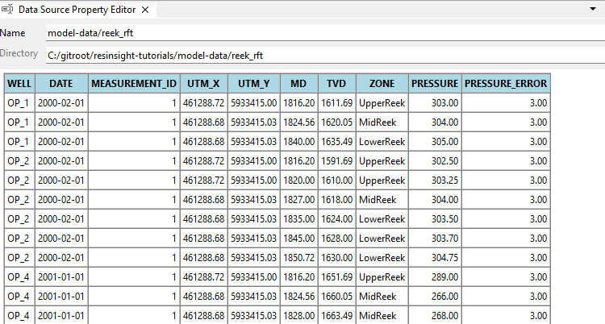
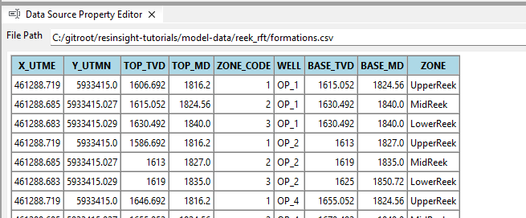
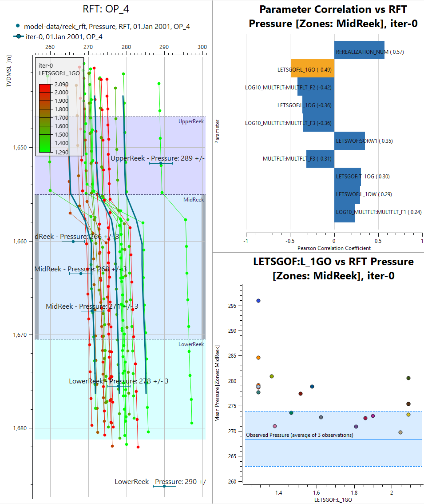

# RFT Correlation Guide

## Overview

The RFT Correlation Report relates the simulated RFT pressure in a well to the ensemble parameters. It combines three linked views: an ensemble RFT plot, a tornado plot ranking the parameters by correlation with the pressure, and a cross plot of the selected parameter against the pressure.

Pressure responses often differ between zones, and a correlation computed over the whole well can hide a strong relationship in a single zone. This guide shows how to restrict the correlation to selected zones using depth-based well picks from an FMU `formations.csv` file. The Reek ensemble with 20 realizations is used.

---

# Getting Started

## Model Data

The ensemble is located in `model-data/1_r001_reek_20_rft`. It contains 20 realizations organized in the FMU folder structure, each with summary data, RFT data and ensemble parameters:

```
realization-0/iter-0/parameters.txt
realization-0/iter-0/eclipse/model/1_R001_REEK-0.SMSPEC
realization-0/iter-0/eclipse/model/1_R001_REEK-0.RFT
...
realization-19/iter-0/eclipse/model/1_R001_REEK-19.RFT
```

Observed RFT data and well picks are located in `model-data/reek_rft`:

| File | Content |
|---|---|
| `well_date_rft.txt` | Wells and dates with observed RFT data |
| `<well>.obs` | Observed pressure and error for each observation |
| `<well>.txt` | Position, depth and zone for each observation |
| `formations.csv` | Well picks: top and base depth of each zone in each well |

The model has three zones: UpperReek, MidReek and LowerReek. This guide uses the well **OP_4**.

## Well Picks File

The `formations.csv` file defines the zones along each well by measured depth (MD) and true vertical depth (TVD). Well picks do not require a well path trajectory, and are independent of K-layer based formation files such as `.lyr` and `layer_zone_table.txt`.

```
X_UTME,Y_UTMN,TOP_TVD,TOP_MD,ZONE_CODE,WELL,BASE_TVD,BASE_MD,ZONE
461288.719,5933415.0,1646.692,1816.2,1,OP_4,1655.052,1824.56,UpperReek
461288.685,5933415.027,1655.052,1824.56,2,OP_4,1670.492,1840.0,MidReek
461288.683,5933415.029,1670.492,1840.0,3,OP_4,1681.212,1850.72,LowerReek
```

The columns **WELL**, **ZONE**, **TOP_MD**, **BASE_MD**, **TOP_TVD** and **BASE_TVD** are used. Other columns are ignored.

---

# Data Import

## Step 1: Import the Summary Ensemble

1. Select **File > Import > Import Grid and Summary Ensemble**
2. Click **...** next to **Path pattern** and select `model-data/1_r001_reek_20_rft`
3. Click **Search** and verify that 20 summary files are found
4. Check **Create Summary Ensemble** only, and click **OK**

The RFT files next to the summary files are imported together with the summary data. The ensemble parameters are read from `parameters.txt` in each realization.

## Step 2: Import Observed RFT Data

1. In the **Plot Window**, right-click **Observed Data** in the **Data Sources** tree
2. Select **Import Observed FMU Data**
3. Select the folder `model-data/reek_rft`

The observed pressures for OP_1, OP_2, OP_4, WI_1 and WI_3 are added to **Observed Data**.

Select the imported item to preview the data in the **Property Editor**. The table lists one row per observation, with the well, date, position, MD, TVD, zone, pressure and error. Verify that each observation is assigned to the expected zone.



## Step 3: Import the Well Picks

1. In the **Data Sources** tree, right-click **Well Picks (Formations)**
2. Select **Import Well Formations...**
3. Select `model-data/reek_rft/formations.csv`

Select the imported file to show its content as a table in the **Property Editor**. Verify that OP_4 has the zones UpperReek, MidReek and LowerReek.



---

# RFT Correlation Workflow

## Step 4: Create an Ensemble RFT Plot

1. Right-click **RFT Plots** in the **Plots** tree and select **New RFT Plot**
2. In the **Property Editor**:
   - Set **Well Name** to **OP_4**
   - Under **Sources**, check the ensemble and the observed FMU data
   - Under **Time Steps**, select the January 2001 time step. Time steps with observed data are marked **O**

The plot shows one simulated pressure curve per realization, together with the observed pressures.

Since OP_4 has no well path trajectory in the project, ResInsight looks for a well picks file containing OP_4. When found, the RFT track uses the **Well Picks (no trajectory)** formation source, and the zones from `formations.csv` are shown as colored bands in the plot.

**Note:** The well picks can also be selected manually. Select the track, set **Zonation/Formation Names > Source** to **Well Picks (no trajectory)**, and select the **Formations File** and **Well**. The **Add Well Picks** button imports a `formations.csv` file and selects it in one step.

## Step 5: Create the RFT Correlation Report

1. Right-click the RFT plot in the **Plots** tree
2. Select **Create RFT Correlation Report**

The report is created under **Ensemble Correlation Plots** and opens in the **Plot Window**. The default layout shows the RFT plot on the left, the tornado plot in the top right and the cross plot in the bottom right.

The report inherits the well, ensemble and time step from the RFT plot. Because the well picks file contains OP_4, the report is set up for formation filtering:

| Field | Value |
|---|---|
| Depth Filter | Formation |
| Well Formations File | formations.csv |
| Zones | None selected |

The first numeric ensemble parameter is selected as **Ensemble Parameter**, and the RFT curves are colored by this parameter.

## Step 6: Filter on Zones

Click a zone band in the RFT plot to add it to the filter:

1. Click inside the **UpperReek** band
2. The zone is marked by a bar along the depth axis
3. The tornado plot and the cross plot are recomputed using only the RFT samples within UpperReek

Click **MidReek** to add a second zone. Click a selected zone again to remove it from the filter. The selected zones are also listed in **Zones** in the **Property Editor** of the report, where they can be edited directly.

Compare the tornado plot for UpperReek only, MidReek only, and both zones. A parameter can have a strong correlation in one zone and a weak correlation in another. OP_4 has three observations in MidReek, which are combined into one observed pressure in the cross plot (see Step 9).

**Note:** Clicking a zone switches **Depth Filter** to **Formation** if another filter was active.

Figure 3 shows the report for OP_4 filtered on MidReek, with the selected zone marked by grey bars along the depth axis. In this zone, *RI:REALIZATION_NUM* has the strongest positive correlation (0.57) and *LETSGOF:L_1GO* the strongest negative correlation (-0.49). The cross plot shows *LETSGOF:L_1GO* against the mean MidReek pressure, with the three MidReek observations combined into one observed pressure.

{height=13cm}

## Step 7: Filter on a Depth Range (Optional)

A depth interval can be used instead of zones:

1. Select the report in the **Plots** tree
2. Set **Depth Filter** to **Depth Range**
3. Enter **Min Depth** and **Max Depth**

The depth range is given in the unit selected in **Depth Unit**, MD or TVD. The interval is marked by a bar along the depth axis in the RFT plot.

Set **Depth Filter** back to **Formation** to continue with the zone filter.

---

# Plot Analysis

## Step 8: Select a Parameter in the Tornado Plot

The tornado plot ranks the ensemble parameters by the Pearson correlation coefficient between the parameter and the RFT pressure within the active filter. Positive correlations extend to the right, negative correlations to the left. The bar of the selected parameter is highlighted.

Click a bar in the tornado plot to select that parameter. The cross plot and the coloring of the RFT curves are updated to use the selected parameter.

Select the tornado plot in the **Plots** tree to configure it:

- **Show Only Top Correlations** and **Number of Rows** -- limit the number of parameters shown
- **Sort by Absolute Values** -- rank by the strength of the correlation, regardless of sign
- **Show Absolute Values** -- show all bars to the right

## Step 9: Review the Cross Plot

The cross plot shows the RFT pressure against the selected parameter. Use it to check the shape of the relationship behind the correlation coefficient, for example whether the trend is linear or driven by a few realizations.

**Sampling** in the **Cross Plot Parameter** group controls the points:

- **Mean per Realization** -- one point per realization, using the mean pressure of the filtered samples
- **All Samples** -- one point per filtered RFT sample

The observed pressure within the filter is drawn as a horizontal line, in the color of its zone. The dashed lines and the shaded band show the observation error. Several observations within the same zone are combined into one line at their mean pressure, with the band covering the full range of the observations.

Parameter values where the simulated pressure falls within the observed band give realizations that match the observations in the selected zones.

## Step 10: Show Plot Data (Optional)

Right-click the tornado plot or the cross plot and select **Show Plot Data** to see the numbers behind the plot. The data can be copied to other applications.

---

# Layout

The three views are dock widgets. To rearrange them, select the report and check **Dock Layout > Show Title Bars**. Drag a panel by its title bar to dock it on another edge, stack it with another panel as tabs, or leave it floating. The layout is stored with the project.
